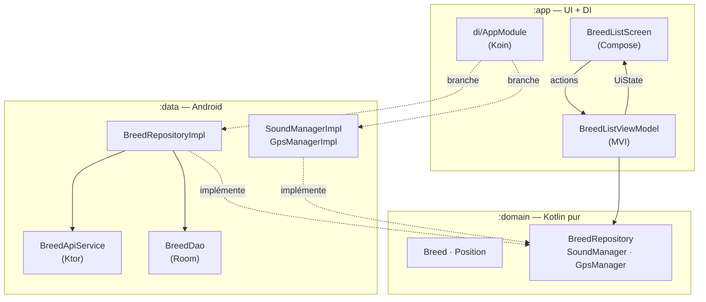
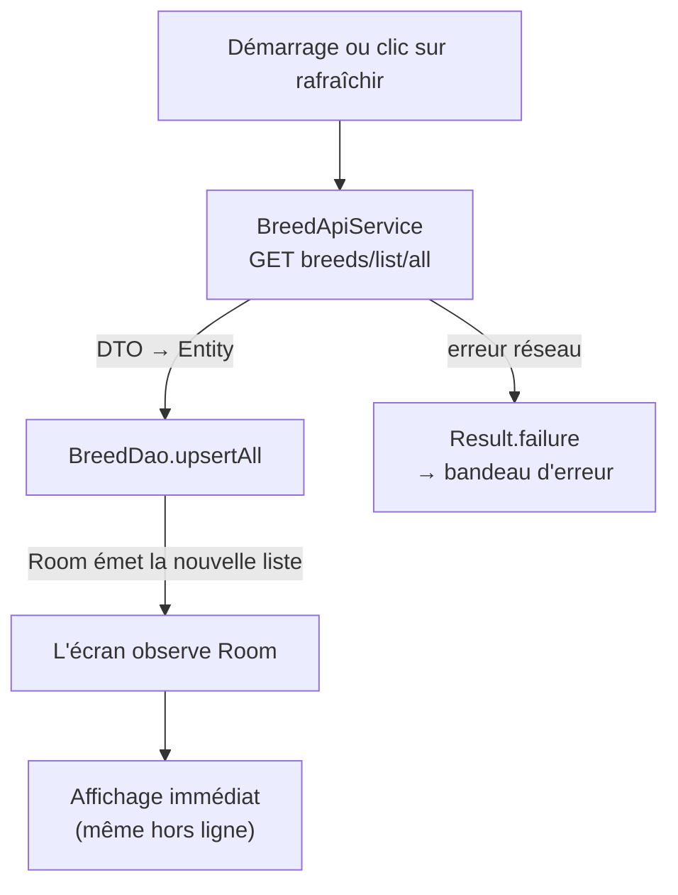

# 🐶 DogCeo


Application Android qui affiche **toutes les races de chiens** et leurs sous-races, grâce à l'API publique [Dog CEO](https://dog.ceo/dog-api/).
Projet d'évaluation Kotlin / Android (DIIAGE 2 · P1, sujet libre).

---

## Ce que fait l'app

| Fonctionnalité | Détail |
|---|---|
| 📋 **Liste des races** | Toutes les races, triées par nom, avec leurs sous-races en dessous |
| 📴 **Hors ligne** | Les races sont gardées sur le téléphone : la liste s'affiche même sans réseau |
| 🔄 **Rafraîchir** | Un bouton retélécharge la liste… et **joue un son** au clic |
| 📍 **Me localiser** | Affiche ta position (latitude, longitude) après avoir accepté la permission |
| ⚠️ **Erreurs gérées** | Un bandeau s'affiche si le réseau échoue ou si la localisation est refusée |
| 🌍 **Deux langues** | Français par défaut, anglais si le téléphone est en anglais |
| 🌙 **Thème clair et sombre** | Suit le réglage du téléphone, avec les couleurs du fond d'écran (Android 12+) |

### 🐯 Le secret du grand tigrou

En haut de l'écran, il y a une **tête de tigre**.
Appuie dessus stp

---

## 🏗️ Architecture

Le projet suit la **Clean Architecture** : le code est rangé en **couches**, et chaque couche est un **module Gradle** séparé. Le **Domain** est au centre et ne dépend de rien.



| Module | Rôle | Dépend de |
|---|---|---|
| `:domain` | Les **modèles** (`Breed`, `Position`) et les **contrats** (interfaces) | rien (Kotlin pur, aucun import `android.*`) |
| `:data` | Les **implémentations** : API, base locale, Managers du matériel | `:domain` |
| `:app` | Les **écrans** Compose, les ViewModels et le branchement **Koin** | `:domain`, `:data` |

👉 Le ViewModel ne connaît que les **interfaces** du Domain : il ne sait pas que derrière, il y a Room, Ktor ou `SoundPool`.

### 🔁 Le chargement des races (offline-first)



L'écran **lit toujours la base locale**. L'API ne sert qu'à la **mettre à jour**. Résultat : pas d'écran vide sans réseau, et une seule source de vérité.

### 🎮 L'écran en MVI

```mermaid
flowchart TD
    U["Utilisateur"] -->|clic| C["BreedListContent"]
    C -->|BreedListAction| V["BreedListViewModel.onAction"]
    V -->|copie de l'état| S["StateFlow&lt;BreedListUiState&gt;"]
    S -->|recomposition| C
```



- **Une seule porte d'entrée** : `onAction(action)`, avec un `when` qui oblige à traiter chaque action.
- **Un seul état** immuable, `BreedListUiState`, qui décrit tout ce qui est affiché.
- **Découpage en Lego** : `Screen` (branché au ViewModel) → `Content` (affichage pur, avec Previews) → composants (`BreedItem`, `ErrorBanner`, `SpinningTiger`).

---

## 🧠 Les choix techniques

| Choix | Pourquoi |
|---|---|
| **3 modules Gradle** (`app`, `data`, `domain`) | Les couches sont séparées **par le compilateur** : `:domain` ne peut pas importer Android, même par erreur |
| **Jetpack Compose + Material 3** | UI déclarative : l'écran se redessine tout seul quand l'état change |
| **MVI** (`UiState` + actions) | Un flux de données dans un seul sens, facile à suivre et à prévisualiser |
| **Koin** | Injection de dépendances simple, sans génération de code ; tout est branché dans `di/AppModule.kt` |
| **Ktor + kotlinx.serialization** | Client HTTP 100 % Kotlin ; `expectSuccess = true` transforme une réponse 4xx / 5xx en erreur |
| **Room** | Base locale qui renvoie un `Flow` : l'écran se met à jour dès que la table change |
| **Offline-first** | L'app reste utilisable sans réseau |
| **Managers** (`SoundManager`, `GpsManager`) | Le matériel est caché derrière une interface du Domain : aucun `getSystemService` dans l'UI |
| **`SoundPool`** | Fait pour les sons courts : le son est chargé une fois, puis rejoué sans délai |
| **`LocationManager`** | API Android de base, sans dépendance Google Play Services |
| **GPS lié au cycle de vie** | `LifecycleResumeEffect` coupe le GPS quand l'écran n'est plus visible, pour la batterie |
| **Permission demandée à l'exécution** | La localisation est une permission **dangereuse** : popup système, et refus géré par un bandeau |
| **Fonction d'extension** `Context.createDogCeoDatabase()` | Crée la base depuis n'importe quel `Context`, avec l'`applicationContext` pour éviter les fuites mémoire |
| **Catalogue de versions** (`libs.versions.toml`) | Toutes les versions au même endroit |
| **Ressources** `values/` + `values-en/` | Aucun texte en dur : tout passe par `stringResource` |

---

## 📁 Organisation du code

```
domain/   model/        Breed, Position
          repository/   BreedRepository
          manager/      SoundManager, GpsManager

data/     remote/       DogCeoHttpClient, BreedApiService, dto/BreedListDto
          local/        DogCeoDatabase, BreedConverters, dao/BreedDao, entity/BreedEntity
          mapper/       BreedMapper (toEntities, toDomain)
          repository/   BreedRepositoryImpl
          manager/      SoundManagerImpl, GpsManagerImpl

app/      di/           AppModule
          ui/screens/   breedList/ (Screen, Content, ViewModel, UiState, Action)
          ui/core/      components/ (BreedItem, ErrorBanner, SpinningTiger), theme/
```

---

## 🔐 Permissions

| Permission | Type | Pourquoi |
|---|---|---|
| `INTERNET` | normale | Télécharger les races depuis l'API |
| `ACCESS_FINE_LOCATION` + `ACCESS_COARSE_LOCATION` | **dangereuse** | Afficher la position ; demandées ensemble, comme l'exige Android 12+ |

---

## 🚀 Lancer le projet

1. Ouvrir le projet dans une version **récente d'Android Studio**, compatible avec **AGP 9.5**.
2. **Sync** Gradle.
3. Lancer l'app sur un émulateur ou un téléphone (Android 10 / API 29 minimum).

En ligne de commande :

```bash
./gradlew assembleDebug
```
